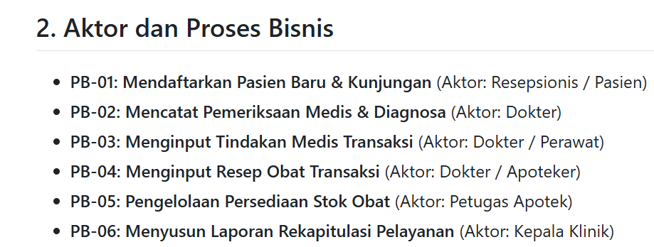
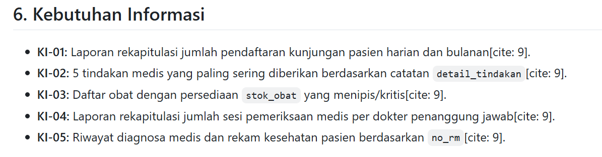

# Laporan Praktikum Basis Data – Pertemuan 2
**Topik:** Analisis Kebutuhan Data, Aturan Bisnis, Kebutuhan Informasi, Matriks CRUD, dan Kamus Data  
**Kode/Nama Repositori:** basisdata-25430026  

---

## I. Identitas Praktikan
* **Nama Lengkap:** Kaylani Eka Putri Damayanti  
* **NIM:** 25430026  
* **Kelas:** Basis Data  
* **Pertemuan Ke:** 2 (Modul 2 - Analisis Kebutuhan Data)  
* **Tanggal Pelaksanaan:** 06 Oktober 2026  

---

## II. Tujuan Praktikum
1. Mampu mengidentifikasi, menganalisis, dan merumuskan Proses Bisnis (PB), Aturan Bisnis (AB), dan Kebutuhan Informasi (KI) dari domain sistem dunia nyata secara komprehensif.
2. Mampu merancang spesifikasi entitas, menetapkan atribut kunci (*Primary Key*, *Alternate Key*, dan *Foreign Key*), serta menyusun Kamus Data (*Data Dictionary*) dan Matriks CRUD secara terstruktur.
3. Mampu menghitung variabel parameter NIM ($P$) dan mengaplikasikannya secara konsisten serta terukur pada atribut transaksional basis data.
4. Mampu mentransformasikan dan memuat perbaikan atas pernyataan kebutuhan data yang kabur (*ambiguous requirements*) menjadi kebutuhan kuantitatif dan teruji.
5. Mampu mengelola, mengorganisasi, dan mendokumentasikan seluruh berkas analisis kebutuhan data (.md) pada repositori GitHub sesuai standar praktikum.

---

## III. Ringkasan Teori
Tahap analisis kebutuhan data merupakan fondasi paling krusial dalam siklus hidup pengembangan basis data (*Database Development Life Cycle* / DDLC). Tahapan ini berfungsi sebagai jembatan antara pemahaman kebutuhan operasional organisasi di dunia nyata dengan perancangan teknis basis data. Tanpa analisis kebutuhan yang matang, rancangan basis data berisiko mengalami kegagalan fungsi, ketidakcocokan struktur data, atau kebocoran integritas informasi saat aplikasi diimplementasikan.

Elemen-elemen utama dalam tahapan analisis kebutuhan data meliputi:
1. **Proses Bisnis (PB):** Urutan langkah-langkah kerja atau aktivitas operasional utama yang dijalankan oleh organisasi (misalnya: Pendaftaran Pasien Baru, Pencatatan Sesi Pemeriksaan Medis, dan Penjualan Barang Koperasi).
2. **Aturan Bisnis (AB):** Kebijakan, batasan teknis, aturan perhitungan, atau validasi operasional yang mengatur jalan jalannya proses bisnis (misalnya: batasan kuantitas maksimum obat dalam resep, rumus perhitungan denda keterlambatan, atau keharusan membekukan harga satuan saat transaksi).
3. **Kebutuhan Informasi (KI):** Laporan, rekapitulasi, ikhtisar, atau output informasi yang dibutuhkan oleh tingkat manajemen/operasional untuk mendukung pengambilan keputusan bisnis.
4. **Matriks CRUD (*Create, Read, Update, Delete*):** Pemetaan dua dimensi yang menghubungkan antara Proses Bisnis (PB) dengan Entitas Data. Matriks ini bertujuan untuk memverifikasi bahwa tidak ada entitas yang terisolasi (*orphan entity*), tidak pernah diisi (*never created*), atau tidak pernah digunakan (*never read*).
5. **Kamus Data (*Data Dictionary*):** Dokumentasi terinci dari setiap entitas yang menjelaskan daftar atribut, tipe data, panjang karakter, batasan *Null/Not Null*, serta status penetapan kunci (*Primary Key*, *Alternate Key*, dan *Foreign Key*).

---

## IV. Langkah Percobaan (D) – Latihan Koperasi Mahasiswa (`kopma_026`)

Pada langkah percobaan ini, dilakukan analisis kebutuhan data untuk Koperasi Mahasiswa (Kopma 026) yang terdiri dari 6 entitas utama: `anggota`, `kasir`, `penjualan`, `penjualan_detail`, `barang`, dan `kategori_barang`.

### 1. Bukti Dokumen Latihan Kopma
Hasil analisis kebutuhan data untuk latihan Koperasi Mahasiswa disusun secara lengkap pada berkas [`p02_kebutuhan_data_kopma_026.md`](../p02_kebutuhan_data_kopma_026.md) di direktori utama repositori. Berkas tersebut memuat penguraian Proses Bisnis (PB-01 s/d PB-05), Aturan Bisnis (AB-01 s/d AB-07 termasuk Poin Loyalitas Anggota), Kebutuhan Informasi (KI-01 s/d KI-05), Matriks CRUD, serta Kamus Data 6 entitas.

### 2. Keterangan Singkat Latihan Kopma
- **Proses Bisnis (PB):** Mengidentifikasi aktivitas pendaftaran anggota baru, transaksi penjualan oleh kasir, pemesanan barang ke pemasok, penerimaan barang, hingga penyusunan laporan bulanan.
- **Kamus Data & Matriks CRUD:** Menyusun 6 entitas baku dengan penetapan Primary Key (`id_anggota`, `id_kasir`, `id_penjualan`, `id_barang`, `id_kategori`) serta entitas asosiatif `penjualan_detail` ber-PK komposit (`id_penjualan`, `id_barang`) yang memuat atribut transaksional `qty_detail_penjualan` dan `harga_satuan_detail_penjualan`.

---

## V. Titik Analisis

### 1. Titik Analisis 1: Pentingnya Penguraian Proses Bisnis (PB) ke Aturan Bisnis (AB) dan Kebutuhan Informasi (KI)
- **Pertanyaan:** Mengapa proses perancangan basis data tidak boleh langsung melompat ke pembuatan tabel/entitas tanpa merumuskan PB, AB, dan KI terlebih dahulu?
- **Jawaban & Alasan Mendalam:** Melompat langsung ke pembuatan tabel tanpa merumuskan PB, AB, dan KI akan berakibat fatal pada keutuhan struktur basis data:
  1. *Kehilangan Atribut Krusial (Under-design):* Tanpa memetakan Kebutuhan Informasi (KI), perancang basis data tidak akan tahu laporan apa saja yang dibutuhkan pimpinan, sehingga atribut laporan yang diperlukan bisa jadi lupa dibuat.
  2. *Penyimpanan Data Sia-sia (Over-design):* Tanpa memetakan Proses Bisnis (PB), perancang berisiko membuat kolom atau tabel yang tidak pernah diisi atau diakses oleh aplikasi.
  3. *Pelanggaran Integritas Data:* Tanpa merumuskan Aturan Bisnis (AB), perancang tidak memiliki panduan untuk menetapkan batasan unik (*Alternate Key*), sifat wajib diisi (*Not Null*), maupun atribut historis/pembekuan harga pada entitas asosiatif.

### 2. Titik Analisis 2: Perhitungan Parameter NIM ($P$)
- **Formula Parameter:**  
  $$P = (26 \pmod 9) + 1 = 8 + 1 = 9$$
- **Langkah Perhitungan dengan NIM `25430026`:**  
  $$26 \pmod 9 = 8$$  
  $$P = 8 + 1 = 9$$
- **Penerapan Parameter $P = 9$ pada Proyek Klinik 026:**
  1. **Batas Maksimal Item Obat per Resep ($P + 2$):**  
     $$\text{Maksimal Item} = 9 + 2 = 11 \text{ item obat per resep}$$
  2. **Tarif Denda Keterlambatan Pembayaran ($P$):**  
     $$\text{Denda per Hari} = \text{Rp9.000 per hari}$$
  3. **Estimasi Volume Transaksi Harian ($40 + (5 \times P)$):**  
     $$40 + (5 \times 9) = 85 \text{ transaksi per hari}$$

### 3. Titik Analisis 3: Perbaikan Tiga Pernyataan Kebutuhan Kabur (*Ambiguous Requirements*)
Berikut adalah analisis dan perbaikan atas tiga pernyataan kebutuhan yang bersifat kualitatif/kabur menjadi spesifik, kuantitatif, dan terukur secara teknis basis data:

1. **Pernyataan Kabur 1:** *"Sistem harus menyimpan data resep obat dengan cepat dan tidak boleh terlalu banyak."*
   - **Perbaikan Terukur:** Sistem wajib mencatat detail resep obat pada entitas `resep_detail` dengan batasan kuantitas maksimal **11 item obat** (berdasarkan parameter $P = 9$) untuk setiap satu transaksi pemeriksaan (`id_pemeriksaan`).
2. **Pernyataan Kabur 2:** *"Pasien yang terlambat membayar tagihan akan dikenakan denda yang sesuai."*
   - **Perbaikan Terukur:** Pasien yang melampaui tenggat pembayaran tagihan pendaftaran/pemeriksaan akan dikenakan denda keterlambatan sebesar **Rp9.000 per hari** (berdasarkan parameter $P = 9$) yang dicatat pada atribut `denda_keterlambatan`.
3. **Pernyataan Kabur 3:** *"Stok obat yang hampir habis harus segera diberi peringatan."*
   - **Perbaikan Terukur:** Sistem akan memicu status peringatan stok kritis (*low stock alert*) apabila nilai pada atribut `stok_obat` di entitas master `obat` berada pada jumlah kurang dari atau sama dengan **15 unit**.

---

## VI. Latihan (E)
Hasil analisis kebutuhan data untuk latihan Koperasi Mahasiswa diselesaikan penuh dan disajikan pada berkas **[`p02_kebutuhan_data_kopma_026.md`](../p02_kebutuhan_data_kopma_026.md)** di folder utama repositori. Berkas ini memuat uraian lengkap 6 entitas, pemetaan tabel PB, AB, KI, Matriks CRUD, serta Kamus Data komprehensif yang telah divalidasi kebenarannya.

---

## VII. Tugas Mandiri (F) – Milestone Proyek 2 (Klinik `klinik_026`)

Tugas mandiri ini merupakan penyusunan dokumen analisis kebutuhan data resmi untuk proyek Klinik Sehat 026 berdasarkan parameter NIM `25430026` ($P = 9$).

### 1. Bukti Tangkapan Layar Berkas Proyek Klinik di GitHub

Berikut adalah bukti tangkapan layar berkas kebutuhan data proyek `klinik_026` pada repositori GitHub sesuai nama berkas di folder `img/`:

#### A. Tangkapan Layar Proses Bisnis (PB) dan Aturan Bisnis (AB)
  
*Gambar 7.1: Tampilan Aktor dan Proses Bisnis (PB-01 s/d PB-06) Klinik Sehat 026 pada repositori GitHub (`imgp02_pb_ab.png`).*

.png)  
*Gambar 7.2: Tampilan Aturan Bisnis (AB-01 s/d AB-08) Klinik Sehat 026 pada repositori GitHub (`imgp02_pb_ab (2).png`).*

#### B. Tangkapan Layar Kebutuhan Informasi (KI) dan Matriks CRUD
  
*Gambar 7.3: Tampilan Kebutuhan Informasi (KI-01 s/d KI-05) Klinik Sehat 026 pada repositori GitHub (`imgp02_ki_crud.png`).*

.png)  
*Gambar 7.4: Tampilan Matriks CRUD 8 Entitas Klinik Sehat 026 pada repositori GitHub (`imgp02_ki_crud (2).png`).*

#### C. Tangkapan Layar Kamus Data Awal
.png)  
*Gambar 7.5: Tampilan Kamus Data Awal Bagian 1 (Atribut Pasien) pada repositori GitHub (`imgp02_kamus_data (1).png`).*

.png)  
*Gambar 7.6: Tampilan Kamus Data Awal Bagian 2 (Atribut Pasien & Dokter) pada repositori GitHub (`imgp02_kamus_data (2).png`).*

.png)  
*Gambar 7.7: Tampilan Kamus Data Awal Bagian 3 (Atribut Pendaftaran, Pemeriksaan, Tindakan) pada repositori GitHub (`imgp02_kamus_data (3).png`).*

.png)  
*Gambar 7.8: Tampilan Kamus Data Awal Bagian 4 (Atribut Tindakan, Resep, Obat) pada repositori GitHub (`imgp02_kamus_data (4).png`).*

---

### 2. Ringkasan Hasil Analisis Kebutuhan Data Klinik 026

#### A. Identifikasi Proses Bisnis (PB)
- **PB-01 (Mendaftarkan Pasien Baru & Kunjungan):** Mencatat identitas pasien baru dan membuat nomor pendaftaran kunjungan harian.
- **PB-02 (Mencatat Pemeriksaan Medis & Diagnosa):** Dokter menginput hasil diagnosa medis berdasarkan nomor pendaftaran pasien.
- **PB-03 (Menginput Tindakan Medis Transaksi):** Pencatatan jenis tindakan medis yang diberikan kepada pasien beserta pembekuan tarif transaksi.
- **PB-04 (Menginput Resep Obat Transaksi):** Pencatatan resep obat (maksimal 11 item) beserta jumlah dan aturan pakai.
- **PB-05 (Pengelolaan Persediaan Stok Obat):** Pembaruan saldo persediaan obat dan penanganan peringatan stok kritis.
- **PB-06 (Pelaporan Rekapitulasi & Keuangan):** Penyajian ikhtisar kunjungan, pendapatan per dokter, dan riwayat rekam medis.

#### B. Matriks CRUD Klinik 026

| Entitas Data | PB-01 (Pendaftaran) | PB-02 (Pemeriksaan) | PB-03 (Tindakan) | PB-04 (Resep) | PB-05 (Stok) | PB-06 (Laporan) |
|---|:---:|:---:|:---:|:---:|:---:|:---:|
| `pasien` | C, R, U | R | - | - | - | R |
| `dokter` | R | R | - | - | - | R |
| `pendaftaran` | C, R, U | R | - | - | - | R |
| `pemeriksaan` | - | C, R, U | R | R | - | R |
| `tindakan` | - | R | R | - | - | R |
| `detail_tindakan` | - | - | C, R, U | - | - | R |
| `obat` | - | - | - | R | R, U | R |
| `resep_detail` | - | - | - | C, R, U | U | R |

#### C. Ringkasan Kamus Data 8 Entitas Klinik 026
1. **`pasien`**: `id_pasien` (PK), `no_rm` (AK), `nik_pasien` (AK), `nama_pasien`, `tgl_lahir_pasien`, `no_hp_pasien`.
2. **`dokter`**: `id_dokter` (PK), `kd_dokter` (AK), `sip_dokter` (AK), `nama_dokter`, `spesialis_dokter`, `tarif_konsultasi_dokter`.
3. **`pendaftaran`**: `id_pendaftaran` (PK), `no_pendaftaran` (AK), `id_pasien` (FK), `tgl_pendaftaran`, `denda_keterlambatan` (Rp9.000/hari).
4. **`pemeriksaan`**: `id_pemeriksaan` (PK), `id_pendaftaran` (FK), `id_dokter` (FK), `tgl_pemeriksaan`, `diagnosa_pemeriksaan`.
5. **`detail_tindakan`**: `id_pemeriksaan` (PK, FK), `id_tindakan` (PK, FK), `qty_detail_tindakan`, `tarif_satuan_detail_tindakan`.
6. **`tindakan`**: `id_tindakan` (PK), `kd_tindakan` (AK), `nama_tindakan`, `tarif_tindakan`.
7. **`resep_detail`**: `id_pemeriksaan` (PK, FK), `id_obat` (PK, FK), `qty_resep_detail` (max 11 item), `aturan_pakai_resep_detail`.
8. **`obat`**: `id_obat` (PK), `kd_obat` (AK), `nama_obat`, `harga_obat`, `stok_obat`.

---

## VIII. Pembahasan dan Kendala
- **Kendala 1:** Menentukan sifat pembekuan tarif pada entitas transaksi agar perubahan harga master tidak merubah riwayat tagihan lama.
  - *Cara Mengatasi:* Menambahkan atribut `tarif_satuan_detail_tindakan` pada entitas `detail_tindakan` untuk menyimpan nilai tarif historis saat transaksi dicatat.
- **Kendala 2:** Pengaturan format tabel Markdown pada GitHub agar matriks CRUD dan Kamus Data terurai dengan rapi tanpa terpotong.
  - *Cara Mengatasi:* Menggunakan pemisah kolom Markdown baku (`|`) serta memastikan tidak ada tag HTML yang rusak di dalam dokumen `.md`.

---

## IX. Kesimpulan
Hasil analisis kebutuhan data untuk Koperasi Mahasiswa (`kopma_026`) dan Klinik Sehat (`klinik_026`) telah berhasil dirumuskan secara lengkap dan konsisten. Perhitungan parameter NIM $P = 9$ telah diterapkan secara terukur pada batasan resep obat (11 item) dan denda keterlambatan (Rp9.000/hari). Matriks CRUD membuktikan seluruh entitas terhubung dengan proses bisnis secara optimal tanpa ada entitas yatim (*orphan entity*).

---

## X. Pernyataan Penggunaan AI
Dalam penyusunan praktikum Modul 2 ini, praktikan menggunakan bantuan AI (Gemini) untuk:
1. Membantu formulasi penyusunan kamus data dan struktur tabel Markdown.
2. Memverifikasi logika matriks CRUD terhadap proses bisnis klinik.
3. Memberikan rekomendasi perbaikan pernyataan kebutuhan yang kabur menjadi kuantitatif.

---

## XI. Bukti Git & Keaslian

### 1. Bukti Repositori & Commit Git
- **URL Repositori GitHub:** `https://github.com/kaylanieka/basisdata-25430026`

### 2. Pernyataan Keaslian
Seluruh berkas dokumen kebutuhan data, tabel analisis, dan laporan dikerjakan secara mandiri oleh praktikan atas nama **Kaylani Eka Putri Damayanti** dengan NIM **25430026**. 
