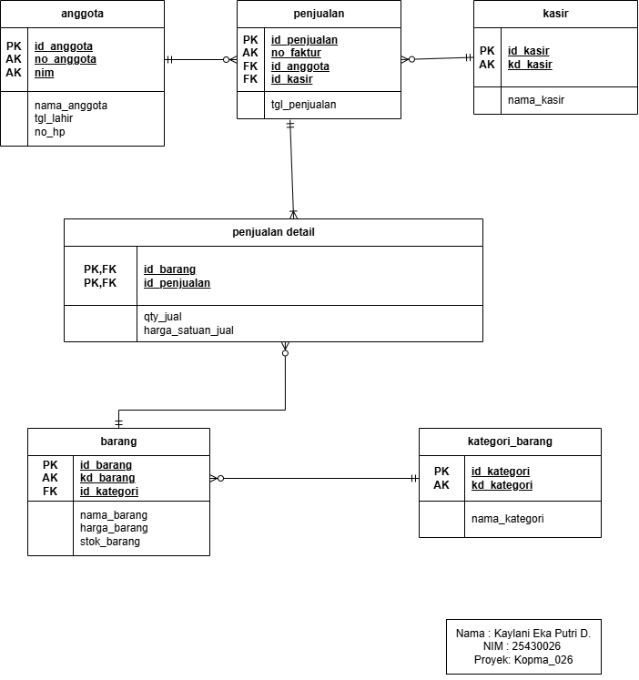

# Laporan Praktikum Basis Data – Pertemuan 3
**Topik:** Perancangan Basis Data Konseptual (Entity-Relationship Diagram / ERD)  
**Kode/Nama Repositori:** basisdata-25430026  

---

## I. Identitas Praktikan
* **Nama Lengkap:** Kaylani Eka Putri Damayanti  
* **NIM:** 25430026  
* **Kelas:** Basis Data  
* **Pertemuan Ke:** 3 (Modul 3 - ERD Konseptual)  
  

---

## II. Tujuan Praktikum
1. Mampu merancang pemodelan basis data konseptual (*Entity-Relationship Diagram* / ERD) berdasarkan analisis kebutuhan data pada Modul 2 menggunakan notasi *Crow's Foot* standar.
2. Mampu menganalisis dan menetapkan atribut kunci (*Primary Key*, *Alternate Key*, dan *Foreign Key*) serta kardinalitas relasi antar-entitas secara akurat.
3. Mampu mentransformasikan relasi *many-to-many* ($M:N$) menjadi entitas asosiatif yang dilengkapi dengan atribut transaksional/historis.
4. Mampu melakukan penelusuran jalur ERD untuk membuktikan pemenuhan seluruh Kebutuhan Informasi (KI) dan Aturan Bisnis (AB) sistem.
5. Mampu mengelola dan mendokumentasikan seluruh artefak proyek basis data (.drawio, .png, .md) secara terstruktur pada repositori GitHub.

---

## III. Ringkasan Teori
Pemodelan basis data konseptual merupakan tahapan krusial dalam siklus hidup pengembangan basis data (*Database Development Life Cycle*). Pemodelan ini bertujuan untuk memetakan kebutuhan dunia nyata (*real-world domain*) ke dalam bentuk abstrak tanpa terikat pada perangkat lunak DBMS tertentu (seperti MySQL, MariaDB, atau PostgreSQL).

Komponen-komponen utama dalam *Entity-Relationship Diagram* (ERD) berbasis notasi *Crow's Foot* meliputi:
1. **Entitas (*Entity*):** Representasi dari objek, orang, tempat, atau kejadian di dunia nyata yang datanya perlu disimpan. Entitas master menyimpan data referensi utama (misal: `pasien`, `dokter`, `obat`), sedangkan entitas transaksional mencatat aktivitas bisnis (misal: `pendaftaran`, `pemeriksaan`).
2. **Atribut (*Attribute*):** Karakteristik atau sifat yang melekat pada entitas.
   - **Primary Key (PK):** Atribut unik tunggal yang membedakan setiap baris data secara pasti.
   - **Alternate Key (AK):** Atribut alternatif yang juga bersifat unik (seperti `no_pendaftaran`, `kode_dokter`, atau `nim`).
   - **Foreign Key (FK):** Atribut kunci tamu yang merujuk pada Primary Key entitas lain untuk membangun relasi.
3. **Kardinalitas Relasi (*Cardinality & Modality*):** Menentukan jumlah minimum dan maksimum kejadian suatu entitas yang dapat diasosiasikan dengan entitas lain.
   - **Mandatory One (`||`):** Wajib ada dan tepat satu.
   - **Optional One (`o|`):** Boleh tidak ada, maksimal satu.
   - **Optional Many (`o<`):** Boleh tidak ada, bisa banyak.
   - **Mandatory Many (`|<`):** Wajib ada minimal satu, bisa banyak.
4. **Entitas Asosiatif (*Associative Entity*):** Entitas penghubung yang dibentuk untuk menguraikan relasi *many-to-many* ($M:N$) menjadi dua relasi $1:N$. Entitas ini sangat penting karena dapat menyimpan atribut transaksional tersendiri (seperti kuantitas dan harga satuan saat transaksi terjadi) untuk menjaga keutuhan riwayat data (*data history preservation*).

---

## IV. Langkah Percobaan (D) – Latihan Koperasi Mahasiswa (`kopma_026`)

Pada langkah percobaan ini, dilakukan perancangan ERD Konseptual untuk sistem Koperasi Mahasiswa (Kopma 026) yang terdiri dari 6 entitas utama: `anggota`, `kasir`, `penjualan`, `penjualan_detail`, `barang`, dan `kategori_barang`.

### 1. Bukti Tangkapan Layar Diagram ERD Kopma

<!-- KETERANGAN SS: Letakkan tangkapan layar file p03_erd_kopma_25430026.png di bawah ini. Pastikan seluruh entitas, atribut PK/AK/FK, serta garis notasi Crow's Foot terbaca dengan jelas. -->

*Gambar 4.1: Tangkapan Layar ERD Konseptual Koperasi Mahasiswa (Kopma 026) di draw.io dengan notasi Crow's Foot dan kardinalitas yang terbaca jelas.*

### 2. Analisis Struktur Entitas dan Relasi Kopma
- **Relasi `anggota` ke `penjualan` (`1` ke `0..N`):** Seorang anggota terdaftar dapat melakukan transaksi pembelian nol atau banyak kali.
- **Relasi `kasir` ke `penjualan` (`1` ke `0..N`):** Seorang kasir melayani nol atau banyak transaksi penjualan.
- **Relasi `penjualan` ke `penjualan_detail` (`1` ke `1..N`):** Satu transaksi penjualan wajib memiliki minimal satu atau banyak item barang yang dibeli.
- **Relasi `barang` ke `penjualan_detail` (`1` ke `0..N`):** Satu item barang master dapat terjual pada nol atau banyak transaksi detail.
- **Relasi `kategori_barang` ke `barang` (`1` ke `0..N`):** Satu kategori barang menaungi nol atau banyak jenis barang.
- **Entitas Asosiatif `penjualan_detail`:** Memecah relasi $M:N$ antara `penjualan` dan `barang`. Entitas ini menyimpan atribut transaksional `qty_jual` dan `harga_satuan_jual` untuk membebukan harga barang saat transaksi terjadi.

---

## V. Titik Analisis

1. **Mengapa relasi *many-to-many* ($M:N$) tidak boleh langsung diimplementasikan dalam basis data relasional dan harus diurai menggunakan Entitas Asosiatif?**
   - **Jawaban:** Relasi $M:N$ secara langsung tidak dapat ditampung oleh struktur tabel relasional tanpa menyebabkan anomali data dan redundansi yang sangat berat. Jika kita memasukkan banyak item barang ke dalam satu baris tabel penjualan, hal tersebut melanggar prinsip First Normal Form (1NF). Oleh karena itu, relasi $M:N$ wajib diurai menjadi dua relasi $1:N$ menggunakan entitas asosiatif. Selain itu, entitas asosiatif berfungsi sebagai wadah untuk menyimpan atribut transaksional (seperti kuantitas dan harga satuan historis) yang tidak bisa menempel di entitas master maupun entitas transaksi utama.

2. **Mengapa harga satuan/tarif harus disimpan kembali pada Entitas Asosiatif (`harga_satuan_jual` / `tarif_satuan_detail_tindakan`), padahal sudah ada di tabel Master (`harga_barang` / `tarif_tindakan`)?**
   - **Jawaban:** Nilai harga atau tarif pada tabel master bersifat dinamis dan dapat berubah sewaktu-waktu akibat inflasi atau kebijakan manajemen baru. Jika entitas transaksional hanya mengandalkan harga dari tabel master, maka setiap kali harga master diubah, seluruh riwayat transaksi lama akan ikut berubah secara otomatis. Hal ini akan merusak laporan keuangan dan rekapitulasi historis. Menyimpan harga/tarif pada entitas asosiatif berfungsi untuk "membekukan" (*freeze*) nilai transaksi pada saat kejadian berlangsung (*point-in-time value*).

---

## VI. Latihan (E)
Dalam sesi latihan ini, dilakukan pengujian keabsahan diagram ERD Konseptual dengan memastikan:
1. Setiap entitas memiliki tepat satu *Primary Key* (PK) yang digarisbawahi tebal.
2. Setiap atribut unik sekunder ditandai dengan *Alternate Key* (AK).
3. Setiap titik hubungan antarentitas dihubungkan dengan notasi *Crow's Foot* baku tanpa ada relasi melingkar (*circular/redundant relationship*).
4. Penggunaan huruf kecil (*snake_case*) dan kata benda tunggal diseragamkan pada seluruh nama entitas dan atribut.

---

## VII. Tugas Mandiri (F) – Milestone Proyek 3 (Klinik `klinik_026`)

Tugas mandiri ini merupakan implementasi pemodelan ERD Konseptual untuk proyek Klinik Sehat 026 berdasarkan parameter NIM `25430026` ($P = 9$).

### 1. Bukti Tangkapan Layar Diagram ERD Proyek Klinik 026

<!-- KETERANGAN SS: Letakkan tangkapan layar file p03_erd_25430026.png di bawah ini. Tangkapan layar ini membuktikan kelengkapan 8 entitas klinik, kardinalitas relasi, serta notasi Crow's Foot pada draw.io. -->

*Gambar 7.1: Tangkapan Layar ERD Konseptual Klinik Sehat 026 di draw.io yang mencakup 8 entitas utama beserta kardinalitas relasi dan entitas asosiatif.*

### 2. Tabel Pemetaan Relasi, Kardinalitas, dan Aturan Bisnis (AB)

| Relasi Entitas | Kardinalitas | Ujung Sisi Kiri | Ujung Sisi Kanan | Kode AB | Penjelasan Aturan Bisnis |
|---|---|---|---|---|---|
| `pasien` ke `pendaftaran` | `1` ke `0..N` | Mandatory 1 (`||`) | Optional Many (`o<`) | **AB-01** | Setiap pasien terdaftar dapat melakukan nol atau banyak transaksi pendaftaran kunjungan. |
| `pendaftaran` ke `pemeriksaan` | `1` ke `0..1` | Mandatory 1 (`||`) | Optional 1 (`o|`) | **AB-02** | Setiap pendaftaran diproses dalam maksimal satu sesi pemeriksaan medis. |
| `dokter` ke `pemeriksaan` | `1` ke `0..N` | Mandatory 1 (`||`) | Optional Many (`o<`) | **AB-03** | Setiap dokter dapat menangani nol atau banyak sesi pemeriksaan medis pasien. |
| `pemeriksaan` ke `detail_tindakan` | `1` ke `1..N` | Mandatory 1 (`||`) | Mandatory Many (`|<`) | **AB-04** | Setiap sesi pemeriksaan wajib mencatat minimal satu atau banyak detail tindakan medis. |
| `tindakan` ke `detail_tindakan` | `1` ke `0..N` | Mandatory 1 (`||`) | Optional Many (`o<`) | **AB-05** | Setiap jenis tindakan master dapat tercantum pada nol atau banyak catatan detail tindakan. |
| `pemeriksaan` ke `resep_detail` | `1` ke `1..N` | Mandatory 1 (`||`) | Mandatory Many (`|<`) | **AB-06** | Setiap sesi pemeriksaan wajib mencatat minimal satu atau banyak item resep obat (maksimal 11 item obat per resep). |
| `obat` ke `resep_detail` | `1` ke `0..N` | Mandatory 1 (`||`) | Optional Many (`o<`) | **AB-07** | Setiap jenis obat master dapat diresepkan pada nol atau banyak catatan resep detail. |

### 3. Tabel Penelusuran Kebutuhan Informasi (KI) pada Jalur ERD

| Kode KI | Deskripsi Kebutuhan Informasi | Entitas yang Terlibat | Jalur Penelusuran pada ERD |
|---|---|---|---|
| **KI-01** | Laporan Rekapitulasi Kunjungan Pasien Harian/Bulanan | `pasien`, `pendaftaran` | `pendaftaran` $\rightarrow$ `pasien` |
| **KI-02** | Laporan Top 5 Tindakan Medis yang Paling Sering Diberikan | `tindakan`, `detail_tindakan`, `pemeriksaan` | `tindakan` $\rightarrow$ `detail_tindakan` $\rightarrow$ `pemeriksaan` |
| **KI-03** | Peringatan Stok Obat Kritis (Stok Minimum) | `obat` | Entitas master `obat` (pengecekan kolom `stok_obat`) |
| **KI-04** | Laporan Rekapitulasi Pemeriksaan dan Pendapatan per Dokter | `dokter`, `pemeriksaan`, `pendaftaran` | `dokter` $\rightarrow$ `pemeriksaan` $\rightarrow$ `pendaftaran` |
| **KI-05** | Riwayat Rekam Medis Transaksi Pasien | `pasien`, `pendaftaran`, `pemeriksaan`, `detail_tindakan`, `resep_detail` | `pasien` $\rightarrow$ `pendaftaran` $\rightarrow$ `pemeriksaan` $\rightarrow$ (`detail_tindakan`, `resep_detail`) |

### 4. Analisis Entitas Asosiatif Klinik Sehat 026
Proyek Klinik Sehat 026 memiliki 2 entitas asosiatif untuk mengurai relasi $M:N$:
1. **`detail_tindakan`**: Mengurai relasi $M:N$ antara `pemeriksaan` dan `tindakan`. Memiliki atribut sendiri: `qty_detail_tindakan` dan `tarif_satuan_detail_tindakan` (untuk membekukan tarif tindakan saat pemeriksaan).
2. **`resep_detail`**: Mengurai relasi $M:N$ antara `pemeriksaan` dan `obat`. Memiliki atribut sendiri: `qty_resep_detail` dan `aturan_pakai_resep_detail` (dosis pemakaian obat).

### 5. Catatan Tinjauan Klien / Stakeholder (Peer Review)
- **Tinjauan 1 (Umpan Balik Rekan A):** Menanyakan pentingnya atribut `tarif_satuan_detail_tindakan` pada `detail_tindakan`.  
  *Keputusan:* **Diterima.** Atribut dipertahankan untuk menjamin integritas data riwayat keuangan agar tidak terpengaruh perubahan tarif master `tindakan`.
- **Tinjauan 2 (Umpan Balik Rekan B):** Menanyakan cara pembatasan maksimum 11 item obat per resep pada diagram ERD.  
  *Keputusan:* **Diterima.** Kardinalitas ERD tetap diset `1` ke `1..N` (Mandatory Many), sedangkan batasan kuantitas 11 item diakomodasi sebagai Aturan Bisnis (AB-06) pada tingkat logika validasi aplikasi.

---

## VIII. Pembahasan dan Kendala
- **Kendala 1:** Saat menggambar garis relasi di draw.io, notasi *Crow's Foot* terkadang berubah menjadi panah biasa atau garis terputus.
  - *Cara Mengatasi:* Mengubah pengaturan garis pada panel kanan (*Style*) menjadi **Orthogonal**, lalu memilih ujung garis **ER Mandatory One (`||`)**, **ER Zero or More (`o<`)**, atau **ER One or More (`|<`)**.
- **Kendala 2:** File `.drawio` yang diunduh tampak seperti kode XML saat diklik dua kali di Windows Explorer.
  - *Cara Mengatasi:* Hal ini wajar karena Windows belum memiliki aplikasi pemutar bawaan untuk file `.drawio`. File dapat di-rename dari `.drawio.xml` menjadi `.drawio`, di-drag ke situs `app.diagrams.net`, dan di-push ke GitHub untuk dirender otomatis.

---

## IX. Kesimpulan
Perancangan ERD Konseptual untuk proyek Koperasi Mahasiswa (`kopma_026`) dan Klinik Sehat (`klinik_026`) telah berhasil diselesaikan dengan memenuhi seluruh standar kelengkapan notasi *Crow's Foot*. Seluruh atribut kunci (PK, AK, FK), entitas asosiatif dengan atribut transaksional, serta jalur penelusuran Kebutuhan Informasi (KI) dan Aturan Bisnis (AB) terbukti akurat dan konsisten dengan hasil analisis pada Modul 2.

---

## X. Pernyataan Penggunaan AI
Dalam penyusunan praktikum Modul 3 ini, praktikan menggunakan bantuan AI (Gemini) untuk:
1. Membantu formulasi struktur penulisan laporan Markdown sesuai kriteria *Checklist* Praktikum.
2. Memverifikasi ketepatan istilah notasi *Crow's Foot* dan penelusuran Kebutuhan Informasi (KI).
3. Memberikan panduan sintaks perintah Git Command Line Interface (CLI) untuk proses *commit* dan *push*.

---

## XI. Bukti Git & Keaslian

### 1. Bukti Repositori & Commit Git
- **URL Repositori GitHub:** `https://github.com/kaylanieka/basisdata-25430026`

### 2. Pernyataan Keaslian
Seluruh berkas laporan, gambar diagram ERD, dan dokumen pendukung dibuat serta dikerjakan secara mandiri oleh praktikan atas nama **Kaylani Eka Putri Damayanti** dengan NIM **25430026**. 
