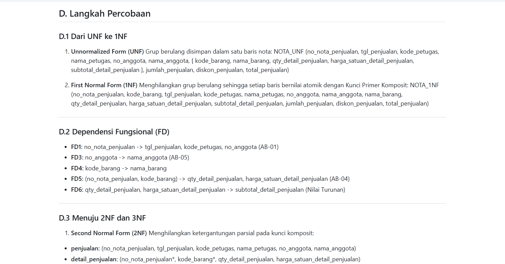
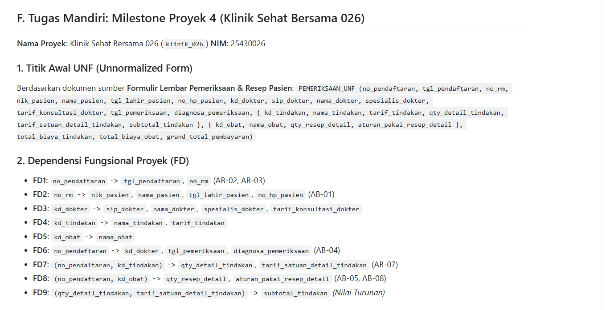

# Laporan Praktikum Basis Data - Pertemuan 4: Normalisasi dan Skema Relasional

## Identitas
- **Nama:** Kaylani Eka Putri Damayanti
- **NIM:** 25430026
- **Kelas:** Basis Data
- **Pertemuan:** 4
- **Tanggal Pelaksanaan:** 19 Oktober 2026

---

## Tujuan
Tujuan dari pelaksanaan praktikum Pertemuan 4 ini adalah sebagai berikut:
1. Memahami konsep dasar dan pentingnya proses normalisasi data dalam perancangan basis data relasional untuk mencegah redundansi dan anomali.
2. Mampu mentransformasikan dokumen sumber tidak terstruktur (*Unnormalized Form* / UNF) menjadi bentuk terstruktur hingga mencapai *Third Normal Form* (3NF) dan *Boyce-Codd Normal Form* (BCNF).
3. Mampu mengidentifikasi dan merumuskan Ketergantungan Fungsional (*Functional Dependency* / FD) antar-atribut berdasarkan aturan bisnis (*Business Rules*) organisasi secara tepat.
4. Mampu mengambil keputusan arsitektural terkait penanganan nilai turunan (*derived values*) dan pembekuan harga historis (*historical prices*) pada entitas transaksi.
5. Memvalidasi skema relasional akhir proyek *Klinik Sehat Bersama 026* (`klinik_026`) agar bebas dari anomali sisip (*insert*), anomali ubah (*update*), dan anomali hapus (*delete*).

---

## Ringkasan Teori

Normalisasi adalah teknik analitis formal yang digunakan dalam perancangan basis data relasional untuk mengorganisasi tabel-tabel sedemikian rupa sehingga mengurangi redundansi data dan meminimalkan risiko inkonsistensi. Proses normalisasi dilakukan secara bertahap melalui serangkaian aturan yang disebut *Normal Forms* (Bentuk Normal).

### 1. Anomali Basis Data
Tanpa normalisasi, basis data rentan terhadap tiga jenis anomali utama:
- **Anomali Sisip (*Insertion Anomaly*):** Ketidakmampuan untuk menambahkan baris data baru ke dalam tabel tanpa harus memasukkan data lain yang tidak relevan atau belum ada.
- **Anomali Ubah (*Update Anomaly*):** Kondisi di mana perubahan pada satu nilai data memerlukan pembaruan pada banyak baris secara berulang; jika ada satu baris yang terlewat, data menjadi tidak konsisten.
- **Anomali Hapus (*Deletion Anomaly*):** Penghapusan satu baris data secara tidak sengaja ikut menghapus data penting lainnya yang sebenarnya masih diperlukan.

### 2. Tahapan Bentuk Normal (*Normal Forms*)
- **Unnormalized Form (UNF):** Bentuk data mentah yang diresapi dari dokumen sumber di mana atribut masih mengandung grup berulang (*repeating groups*) atau nilai non-atomik.
- **First Normal Form (1NF):** Diperoleh dengan memastikan bahwa setiap atribut bernilai atomik (satu sel berisi satu nilai tunggal) dan menghilangkan grup berulang dengan membentuk kunci primer komposit (*composite primary key*).
- **Second Normal Form (2NF):** Memenuhi kriteria 1NF dan memastikan bahwa seluruh atribut bukan kunci memiliki ketergantungan penuh (*full functional dependency*) pada seluruh Kunci Primer. Ketergantungan parsial (*partial dependency*) harus dipisahkan ke tabel terpisah.
- **Third Normal Form (3NF):** Memenuhi kriteria 2NF dan menghilangkan ketergantungan transitif (*transitive dependency*), yaitu kondisi di mana atribut bukan kunci bergantung pada atribut bukan kunci lainnya.
- **Boyce-Codd Normal Form (BCNF):** Bentuk 3NF yang diperketat di mana untuk setiap Ketergantungan Fungsional $X \rightarrow Y$, $X$ harus merupakan kunci kandidat (*superkey*).

---

## Langkah Percobaan (D)

Pada langkah percobaan ini, dianalisis formulir nota penjualan pada Koperasi Mahasiswa (Kopma) untuk mentransformasikan data dari bentuk mentah UNF hingga 3NF.

### 1. Tahapan Normalisasi Kasus Kopma
- **UNF:** `NOTA_UNF (no_nota_penjualan, tgl_penjualan, kode_petugas, nama_petugas, no_anggota, nama_anggota, { kode_barang, nama_barang, qty_detail_penjualan, harga_satuan_detail_penjualan, subtotal_detail_penjualan }, jumlah_penjualan, diskon_penjualan, total_penjualan)`
- **1NF:** `NOTA_1NF (no_nota_penjualan, kode_barang, tgl_penjualan, kode_petugas, nama_petugas, no_anggota, nama_anggota, nama_barang, qty_detail_penjualan, harga_satuan_detail_penjualan, subtotal_detail_penjualan, jumlah_penjualan, diskon_penjualan, total_penjualan)`
- **2NF:** 
  - `penjualan` (`no_nota_penjualan`, `tgl_penjualan`, `kode_petugas`, `nama_petugas`, `no_anggota`, `nama_anggota`)
  - `detail_penjualan` (`no_nota_penjualan`*, `kode_barang`*, `qty_detail_penjualan`, `harga_satuan_detail_penjualan`)
  - `barang` (`kode_barang`, `nama_barang`)
- **3NF:**
  - `PETUGAS` (`kode_petugas`, `nama_petugas`)
  - `ANGGOTA` (`no_anggota`, `nama_anggota`)
  - `PENJUALAN` (`no_nota_penjualan`, `tgl_penjualan`, `kode_petugas`*, `no_anggota`*, `bayar_penjualan`)
  - `DETAIL_PENJUALAN` (`no_nota_penjualan`*, `kode_barang`*, `qty_detail_penjualan`, `harga_satuan_detail_penjualan`)
  - `BARANG` (`kode_barang`, `nama_barang`, `kategori_barang`, `harga_jual_barang`, `stok_barang`, `stok_min_barang`)

### Tangkapan Layar Hasil Langkah Kunci Modul 4

  
*Gambar 1: Bukti pengerjaan langkah percobaan normalisasi dokumen Kopma dari UNF hingga 3NF beserta penulisan Dependensi Fungsional pada berkas `p04_normalisasi_25430026.md` (`gambarp04_langkah_percobaan.png.png`).*

---

## Titik Analisis

1. **Mengapa `harga_satuan_detail_penjualan` diletakkan pada kunci komposit `(no_nota_penjualan, kode_barang)` dan tidak di tabel `barang` saja?**
   - **Jawaban:** Atribut `harga_satuan_detail_penjualan` diletakkan pada tabel transaksi detail untuk mencatat nilai **harga historis** pada saat transaksi terjadi. Jika harga barang di tabel master `barang` berubah (misalnya mengalami kenaikan harga di masa depan), nilai transaksi lama yang sudah tercatat pada nota tidak boleh ikut berubah. Hal ini krusial untuk menjaga integritas dan akurasi laporan keuangan organisasi.

2. **Mengapa nilai total penjualan tidak disimpan di tabel `penjualan`?**
   - **Jawaban:** Nilai `total_penjualan` merupakan nilai turunan (*derived value*) yang dikalkulasikan secara matematis dari penjumlahan subtotal barang. Dalam basis data operasional (OLTP), nilai ini **tidak disimpan** guna mencegah terjadinya anomali ketidakselarasan data (*inconsistency anomaly*). Jika terjadi perubahan item barang atau kuantitas pada detail nota, total belanjaan dihitung secara dinamis melalui kueri SQL (`SUM`) sehingga data selalu terjamin konsistensinya.

3. **Mengapa informasi pemasok tidak disimpan langsung pada tabel `barang`?**
   - **Jawaban:** Menyimpan informasi pemasok langsung di tabel master `barang` akan melanggar 3NF dan menimbulkan ketergantungan transitif, serta membatasi fleksibilitas organisasi. Kopma dapat membeli satu jenis barang dari pemasok yang berbeda-beda pada waktu yang berbeda. Oleh karena itu, informasi pemasok dicatat secara terpisah melalui entitas `pemasok` dan dihubungkan lewat transaksi `pembelian`.

---

## Latihan (E)

### 1. Normalisasi Pencatatan Beberapa Nomor Telepon Pemasok
- **Identifikasi Masalah:** Menyimpan beberapa nomor telepon dalam satu kolom pada tabel `pemasok` melanggar aturan **1NF** karena nilai kolom menjadi tidak atomik.
- **Solusi Normalisasi (3NF):** Membuat entitas terpisah bernama `telepon_pemasok` yang dihubungkan ke tabel utama `pemasok` menggunakan relasi *Foreign Key*.
- **Hasil Relasi Baru:**
  - `pemasok` (`id_pemasok`, `nama_pemasok`, `alamat_pemasok`)
  - `telepon_pemasok` (`id_telepon`, `id_pemasok`*, `no_telepon`)

### 2. Anomali Ubah pada Pelanggaran 3NF
- **Bentuk Pelanggaran:** Ketergantungan transitif `id_penjualan -> id_anggota -> nama_anggota`.
- **Contoh Kueri Ubah yang Memperlihatkan Anomali:**
  ```sql
  -- Mengubah nama anggota hanya pada satu baris transaksi menyebabkan nama anggota untuk id_anggota 5 pada baris transaksi lainnya menjadi tidak konsisten.
  UPDATE penjualan 
  SET nama_anggota = 'Budi Setiawan' 
  WHERE id_penjualan = 1;
  ```

---

## Tugas Mandiri (F): Milestone Proyek 4

**Nama Proyek:** Klinik Sehat Bersama 026 (`klinik_026`)  
**Penyusun:** Kaylani Eka Putri Damayanti (25430026)

### 1. Analisis Dependensi Fungsional Proyek (FD)
- **FD1:** `no_pendaftaran` -> `tgl_pendaftaran`, `no_rm` (AB-02, AB-03)
- **FD2:** `no_rm` -> `nik_pasien`, `nama_pasien`, `tgl_lahir_pasien`, `no_hp_pasien` (AB-01)
- **FD3:** `kd_dokter` -> `sip_dokter`, `nama_dokter`, `spesialis_dokter`, `tarif_konsultasi_dokter`
- **FD4:** `kd_tindakan` -> `nama_tindakan`, `tarif_tindakan`
- **FD5:** `kd_obat` -> `nama_obat`
- **FD6:** `no_pendaftaran` -> `kd_dokter`, `tgl_pemeriksaan`, `diagnosa_pemeriksaan` (AB-04)
- **FD7:** `(no_pendaftaran, kd_tindakan)` -> `qty_detail_tindakan`, `tarif_satuan_detail_tindakan` (AB-07)
- **FD8:** `(no_pendaftaran, kd_obat)` -> `qty_resep_detail`, `aturan_pakai_resep_detail` (AB-05, AB-08)

### 2. Ringkasan Skema Relasional 3NF / BCNF Proyek
- `pasien` (`id_pasien`, `no_rm`, `nik_pasien`, `nama_pasien`, `tgl_lahir_pasien`, `no_hp_pasien`)
- `dokter` (`id_dokter`, `kd_dokter`, `sip_dokter`, `nama_dokter`, `spesialis_dokter`, `tarif_konsultasi_dokter`)
- `tindakan` (`id_tindakan`, `kd_tindakan`, `nama_tindakan`, `tarif_tindakan`)
- `obat` (`id_obat`, `kd_obat`, `nama_obat`, `stok_obat`)
- `pendaftaran` (`id_pendaftaran`, `no_pendaftaran`, `id_pasien`*, `tgl_pendaftaran`)
- `pemeriksaan` (`id_pemeriksaan`, `id_pendaftaran`*, `id_dokter`*, `tgl_pemeriksaan`, `diagnosa_pemeriksaan`)
- `detail_tindakan` (`id_pemeriksaan`*, `id_tindakan`*, `qty_detail_tindakan`, `tarif_satuan_detail_tindakan`)
- `resep_detail` (`id_pemeriksaan`*, `id_obat`*, `qty_resep_detail`, `aturan_pakai_resep_detail`)

### Tangkapan Layar Berkas Wajib dan Normalisasi Proyek

  
*Gambar 2: Berkas wajib p04_normalisasi_25430026.md - Titik Awal UNF dan Dependensi Fungsional Proyek Klinik 026 (`gambarp04_normalisasi_proyek.png.png`).*

.png)  
*Gambar 3: Berkas wajib p04_normalisasi_25430026.md - Tahapan Normalisasi Proyek 1NF dan 2NF Klinik 026 (`gambarp04_normalisasi_proyek.png (2).png`).*

.png)  
*Gambar 4: Berkas wajib p04_normalisasi_25430026.md - Skema 3NF, Evaluasi BCNF, Keputusan Nilai Turunan, dan Catatan ERD Klinik 026 (`gambarp04_normalisasi_proyek.png (3).png`).*

### 3. Penjelasan Keputusan Desain
- **Penyimpanan Nilai Turunan:** Seluruh kalkulasi seperti `subtotal_tindakan`, `total_biaya_tindakan`, `total_biaya_obat`, dan `grand_total_pembayaran` **tidak disimpan** di basis data operasional. Nilai ini dihitung secara dinamis menggunakan ekspresi matematika dan kueri agregat `SUM()`. Namun, `tarif_satuan_detail_tindakan` **wajib disimpan** pada entitas `detail_tindakan` sesuai Aturan Bisnis AB-07 untuk membekukan riwayat tarif tagihan pasien saat transaksi berlangsung.
- **Status Evaluasi ERD Proyek:** Berdasarkan hasil pengujian 1NF hingga BCNF, struktur ERD konseptual pada Pertemuan 3 (`p03_erd_25430026.png`) dinyatakan **100% valid dan tidak mengalami perubahan**. Entitas asosiatif (`detail_tindakan` dan `resep_detail`) serta penggunaan Kunci Pengganti (*Surrogate Key*) `id_*` telah terbukti optimal dan bebas dari anomali.

---

## Pembahasan dan Kendala

- **Kendala / Galat yang Ditemui:** Pada awal tahap 2NF, timbul keraguan dalam menentukan posisi peletakan atribut `tarif_satuan_detail_tindakan`. Muncul pertanyaan apakah tarif cukup diambil dari tabel master `tindakan` melalui klausa `JOIN` atau harus dicatat ulang pada entitas transaksi `detail_tindakan`.
- **Cara Membaca & Mengatasi Kendala:** Kendala diatasi dengan membaca kembali Aturan Bisnis **AB-07**. Dipahami bahwa jika master harga tindakan diperbarui oleh manajemen klinik, data tagihan pasien pada masa lalu tidak boleh ikut berubah. Oleh karena itu, diputuskan bahwa `tarif_satuan_detail_tindakan` adalah atribut transaksional yang wajib disimpan pada tabel `detail_tindakan`.

---

## Kesimpulan
Dari pelaksanaan praktikum Pertemuan 4 ini, dapat disimpulkan bahwa:
1. Proses normalisasi merupakan langkah krusial dalam perancangan basis data untuk mentransformasikan data tidak terstruktur (UNF) menjadi skema relasional yang efisien, konsisten, dan terhindar dari anomali.
2. Formulasi Ketergantungan Fungsional (FD) yang tepat menjamin bahwa setiap ketergantungan antar-atribut didasarkan secara mutlak pada Aturan Bisnis (AB) organisasi.
3. Skema basis data proyek *Klinik Sehat Bersama 026* (`klinik_026`) yang dikembangkan dari Pertemuan 3 telah berhasil diuji dan terbukti memenuhi kriteria **3NF dan BCNF**, sehingga struktur ERD dinyatakan stabil dan siap diimplementasikan ke tahap DDL SQL pada Modul 5.

---

## Pernyataan Penggunaan AI
Praktikum ini memanfaatkan asisten AI Google Gemini sebagai alat bantu diskusi (*thought partner*) untuk memperjelas konsep analisis Ketergantungan Fungsional (FD), memeriksa kepatuhan skema terhadap aturan BCNF, serta menyusun dokumentasi laporan Markdown sesuai dengan standar checklist panduan praktikum.

---

## Bukti Git
- **Tautan Repositori:** https://github.com/kaylanieka/basisdata-25430026

---

## Keaslian
Seluruh tangkapan layar dan dokumen pendukung yang dilampirkan dalam laporan ini diambil secara mandiri langsung dari layar komputer lokal dengan menampilkan identitas akun GitHub `kaylanieka`, NIM `25430026`, serta jam sistem yang aktif saat pengerjaan praktikum.  
  
