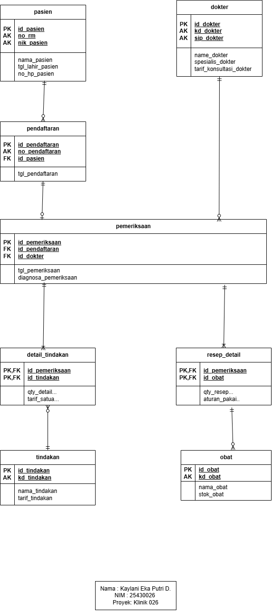

# Dokumentasi ERD Konseptual Proyek Klinik Sehat 026

**Nama Basis Data:** klinik_026  
**Penyusun:** Kaylani Eka Putri Damayanti  
**NIM:** 25430026  
**Kelas:** Basis Data  

---

## 1. Diagram ERD Konseptual

---

## 2. Derajat Relasi dan Kardinalitas

Diagram ERD Konseptual Klinik 026 dirancang menggunakan notasi *Crow's Foot* yang terdiri dari 8 entitas utama. Penjelasan kardinalitas dan jenis garis relasi antar entitas adalah sebagai berikut:

| Relasi Entitas | Kardinalitas | Ujung Sisi Kiri | Ujung Sisi Kanan | Penjelasan Aturan Bisnis |
|---|---|---|---|---|
| `pasien` ke `pendaftaran` | `1` ke `0..N` | Mandatory 1 (`||`) | Optional Many (`o<`) | Tepat satu pasien terdaftar dapat memiliki nol atau banyak transaksi pendaftaran kunjungan. |
| `pendaftaran` ke `pemeriksaan` | `1` ke `0..1` | Mandatory 1 (`||`) | Optional 1 (`o|`) | Tepat satu pendaftaran dapat diproses ke dalam nol atau maksimal satu sesi pemeriksaan medis. |
| `dokter` ke `pemeriksaan` | `1` ke `0..N` | Mandatory 1 (`||`) | Optional Many (`o<`) | Tepat satu dokter dapat menangani nol atau banyak sesi pemeriksaan medis pasien. |
| `pemeriksaan` ke `detail_tindakan` | `1` ke `1..N` | Mandatory 1 (`||`) | Mandatory Many (`|<`) | Tepat satu sesi pemeriksaan wajib memiliki minimal satu atau banyak catatan detail tindakan medis. |
| `tindakan` ke `detail_tindakan` | `1` ke `0..N` | Mandatory 1 (`||`) | Optional Many (`o<`) | Tepat satu jenis tindakan master dapat tercantum pada nol atau banyak catatan detail tindakan. |
| `pemeriksaan` ke `resep_detail` | `1` ke `1..N` | Mandatory 1 (`||`) | Mandatory Many (`|<`) | Tepat satu sesi pemeriksaan wajib memiliki minimal satu atau banyak item resep obat. |
| `obat` ke `resep_detail` | `1` ke `0..N` | Mandatory 1 (`||`) | Optional Many (`o<`) | Tepat satu jenis obat master dapat diresepkan pada nol atau banyak catatan resep detail. |

---

## 3. Pemetaaan Entitas terhadap Proses Bisnis (PB) dan Kebutuhan Informasi (KI)

### A. Pemetaaan Entitas ke Proses Bisnis (Modul 2)
1. **`pasien` & `pendaftaran`**: Mendukung **PB-01** (Mendaftarkan Pasien Baru & Kunjungan) dan **PB-06** (Laporan Rekapitulasi).
2. **`dokter` & `pemeriksaan`**: Mendukung **PB-02** (Mencatat Pemeriksaan Medis & Diagnosa).
3. **`detail_tindakan` & `tindakan`**: Mendukung **PB-03** (Menginput Tindakan Medis Transaksi).
4. **`resep_detail` & `obat`**: Mendukung **PB-04** (Menginput Resep Obat Transaksi) dan **PB-05** (Pengelolaan Persediaan Stok Obat).

### B. Penelusuran Kebutuhan Informasi (KI) pada Jalur ERD
- **KI-01 (Rekapitulasi Kunjungan Harian/Bulanan):** Menelusuri jalur `pendaftaran` $\rightarrow$ `pasien`.
- **KI-02 (Top 5 Tindakan Medis):** Menelusuri jalur `detail_tindakan` $\rightarrow$ `tindakan` $\rightarrow$ `pemeriksaan`.
- **KI-03 (Peringatan Stok Obat Kritis):** Menelusuri entitas master `obat` berdasarkan saldo `stok_obat`.
- **KI-04 (Rekapitulasi Pemeriksaan per Dokter):** Menelusuri jalur `dokter` $\rightarrow$ `pemeriksaan` $\rightarrow$ `pendaftaran`.
- **KI-05 (Riwayat Rekam Medis Pasien):** Menelusuri jalur `pasien` $\rightarrow$ `pendaftaran` $\rightarrow$ `pemeriksaan`.

---

## 4. Analisis Entitas Asosiatif dan Atribut Transaksional

1. **`detail_tindakan`**
   - **Tipe:** Entitas Asosiatif (Penghubung relasi $M:N$ antara `pemeriksaan` dan `tindakan`).
   - **Atribut Kunci:** `id_pemeriksaan` (PK, FK) dan `id_tindakan` (PK, FK).
   - **Atribut Transaksional:** 
     - `qty_detail_tindakan`: Jumlah kuantitas tindakan yang diberikan.
     - `tarif_satuan_detail_tindakan`: Menyimpan harga/tarif tindakan pada saat transaksi berlangsung (mencatat nilai historis agar tidak terpengaruh jika tarif master pada entitas `tindakan` berubah di kemudian hari).

2. **`resep_detail`**
   - **Tipe:** Entitas Asosiatif (Penghubung relasi $M:N$ antara `pemeriksaan` dan `obat`).
   - **Atribut Kunci:** `id_pemeriksaan` (PK, FK) dan `id_obat` (PK, FK).
   - **Atribut Transaksional:** 
     - `qty_resep_detail`: Jumlah kuantitas unit obat yang diresepkan.
     - `aturan_pakai_resep_detail`: Petunjuk dosis dan aturan pemakaian obat bagi pasien.

---

## 5. Catatan Tinjauan Klien / Stakeholder

- **Umpan Balik Klien:** Manajemen klinik meminta agar perubahan tarif tindakan master maupun harga obat master di kemudian hari tidak merubah catatan riwayat tagihan pasien yang sudah lalu.
- **Keputusan Desain Basis Data:** Diterima dan diakomodasi. Ditambahkan atribut `tarif_satuan_detail_tindakan` pada entitas asosiatif `detail_tindakan` untuk membekukan nilai transaksi historis. 
